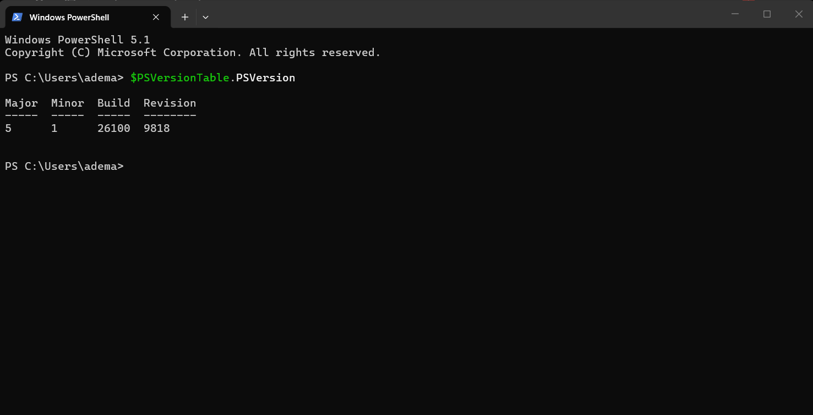
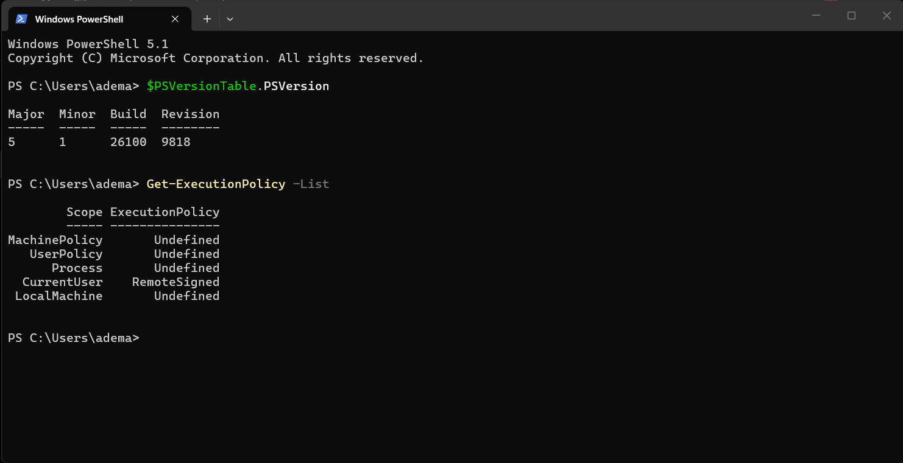
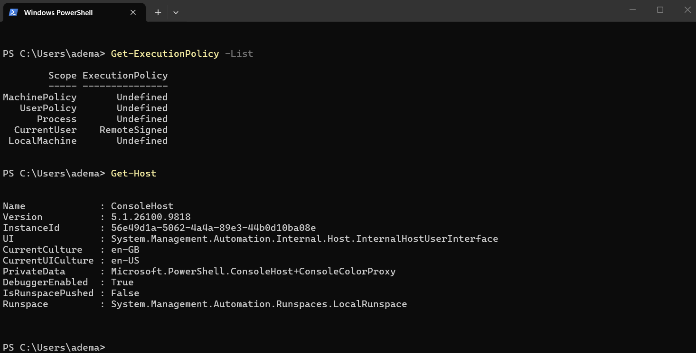
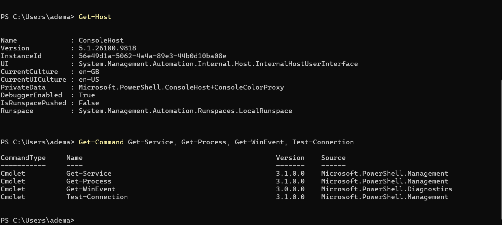
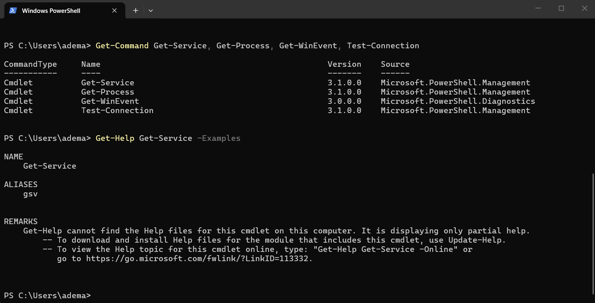
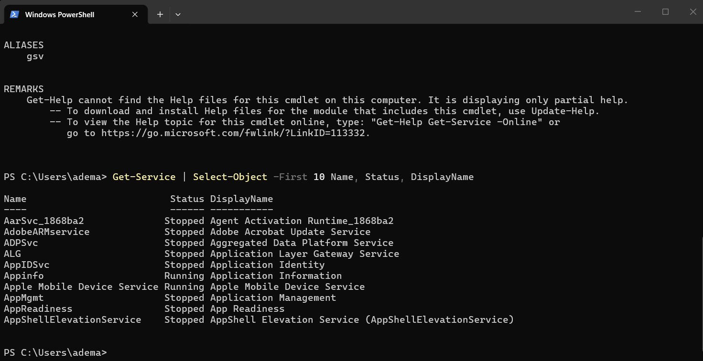

# Lab 01 — PowerShell Environment Setup

**Status:** Complete  
**Date:** 14 November 2026  
**Environment:** Personal Windows laptop  
**PowerShell Version:** Windows PowerShell 5.1.26100.9818

## Objective

Verify that Windows PowerShell is available and correctly configured for basic IT Support and Service Desk tasks, including system inspection, command discovery, service monitoring, and troubleshooting.

## Lab Environment

| Component | Details |
|---|---|
| Operating System | Microsoft Windows |
| PowerShell | Windows PowerShell 5.1 |
| Host | ConsoleHost |
| Device | Personal Windows laptop |
| Permissions | Standard user session |
| Lab Type | Read-only system inspection |

## Practical Exercises

### Exercise 1 — PowerShell Version Verification

**Objective:** Identify the installed PowerShell version.

**Command:**

```powershell
$PSVersionTable.PSVersion
```

**Result:**
- Major version: 5
- Minor version: 1
- Build: 26100
- Revision: 9818

**Outcome:** Successfully verified that Windows PowerShell 5.1 is installed and operational.

**Screenshot:**



---

### Exercise 2 — Execution Policy Verification

**Objective:** Inspect the PowerShell execution policies without modifying system settings.

**Command:**

```powershell
Get-ExecutionPolicy -List
```

**Result:**

| Scope | Execution Policy |
|---|---|
| MachinePolicy | Undefined |
| UserPolicy | Undefined |
| Process | Undefined |
| CurrentUser | RemoteSigned |
| LocalMachine | Undefined |

**Outcome:** Confirmed that the CurrentUser execution policy is RemoteSigned.

RemoteSigned generally allows locally created scripts to run without a digital signature, while downloaded scripts may require a trusted signature unless explicitly unblocked.

No configuration changes were required.

**Screenshot:**



---

### Exercise 3 — PowerShell Host Identification

**Objective:** Identify the PowerShell host environment.

**Command:**

```powershell
Get-Host
```

**Result:**
- Host name: ConsoleHost
- Version: 5.1.26100.9818
- Current culture: en-GB
- UI culture: en-US

**Outcome:** Successfully identified the PowerShell host and confirmed that the console environment is operational.

**Screenshot:**



---

### Exercise 4 — Essential IT Support Command Verification

**Objective:** Verify the availability of common PowerShell troubleshooting commands.

**Command:**

```powershell
Get-Command Get-Service, Get-Process, Get-WinEvent, Test-Connection
```

**Result:**

| Command | Purpose | Status |
|---|---|---|
| Get-Service | Inspect Windows services | Available |
| Get-Process | View running processes | Available |
| Get-WinEvent | Investigate Windows event logs | Available |
| Test-Connection | Test network connectivity | Available |

**Outcome:** All four commands were successfully identified.

These commands will be used in subsequent IT Support labs.

**Screenshot:**



---

### Exercise 5 — PowerShell Help System

**Objective:** Learn how to access PowerShell command documentation.

**Command:**

```powershell
Get-Help Get-Service -Examples
```

**Result:**

PowerShell recognised the Get-Service command and displayed partial help information.

The system indicated that detailed help files were not installed.

**Outcome:** Confirmed that the PowerShell help system is accessible.

Detailed help files can be installed later if required.

**Screenshot:**



---

### Exercise 6 — Windows Service Information

**Objective:** Retrieve information about Windows services using PowerShell.

**Command:**

```powershell
Get-Service | Select-Object -First 10 Name, Status, DisplayName
```

**Result:**

Successfully retrieved information about 10 Windows services.

The output included:
- Service name
- Current service status
- Service display name

Both Running and Stopped service statuses were displayed.

**Outcome:** Successfully demonstrated basic Windows service inspection and PowerShell pipeline usage.

No services were started, stopped, or modified.

**Screenshot:**



---

## Skills Practised

- PowerShell environment verification
- PowerShell version identification
- Execution policy inspection
- PowerShell host identification
- Command discovery using Get-Command
- Command documentation using Get-Help
- Windows service information gathering
- PowerShell pipeline usage
- Basic Windows system administration
- Technical documentation

## Safety Considerations

All exercises were completed using read-only PowerShell commands on a personal Windows laptop.

No user accounts, Windows services, network settings, or security configurations were modified.

Future exercises involving account management, service configuration, or potentially disruptive automation will be performed in an isolated virtual machine where appropriate.

## Troubleshooting Observations

**Observation 1: Missing detailed PowerShell help files**

The Get-Help command returned limited information because detailed help files were not installed.

**Resolution:** No immediate action required. The command remains functional, and detailed help files can be installed later.

**Observation 2: Windows services showing Stopped status**

Some services displayed a Stopped status.

**Resolution:** No action required. Certain Windows services start only when needed. A Stopped status does not automatically indicate a fault.

## Lab Summary

| Exercise | Status |
|---|---|
| PowerShell Version Verification | Complete |
| Execution Policy Verification | Complete |
| PowerShell Host Identification | Complete |
| Essential Command Verification | Complete |
| PowerShell Help System | Complete |
| Windows Service Information | Complete |

**Total Exercises Completed: 6/6**

## Conclusion

Lab 01 — PowerShell Environment Setup was completed successfully.

The exercises verified that Windows PowerShell 5.1 is operational and capable of performing basic IT Support information-gathering tasks.

The lab demonstrated command discovery, execution policy inspection, PowerShell help usage, and Windows service monitoring.

All six practical exercises were documented with screenshot evidence.

**Next Lab:** Lab 02 — System Information and Inventory.
