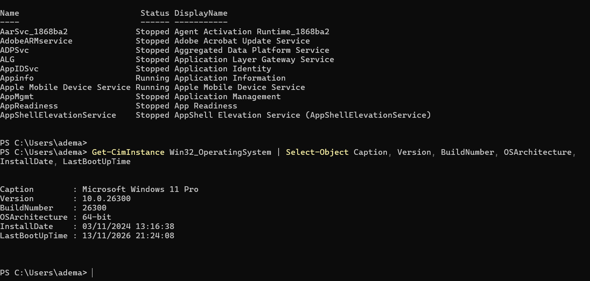
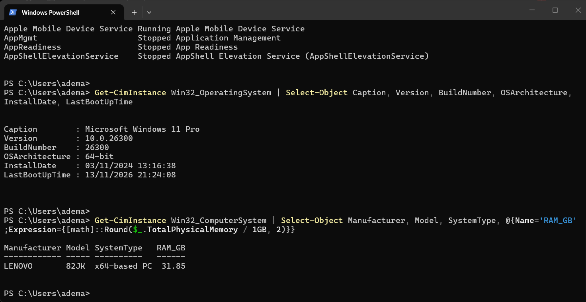
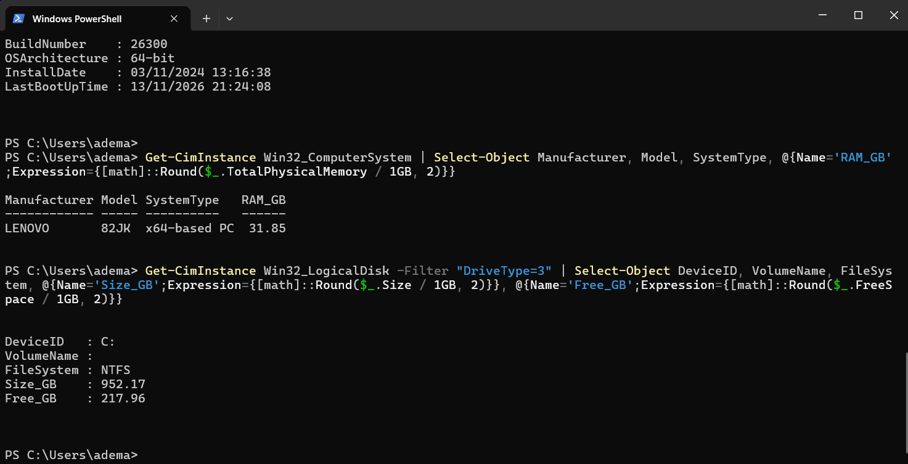
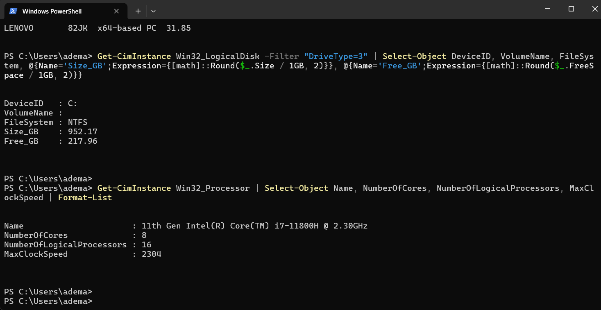
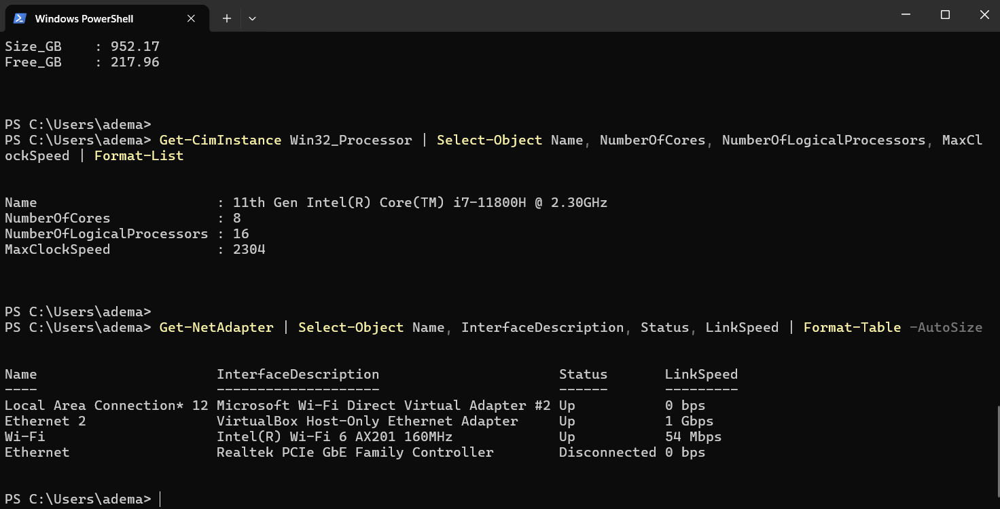
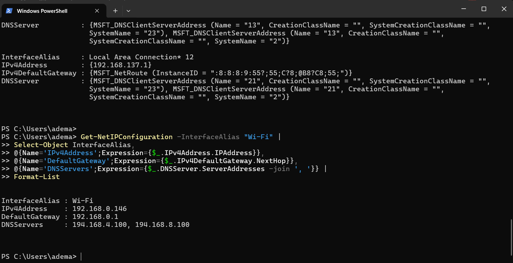
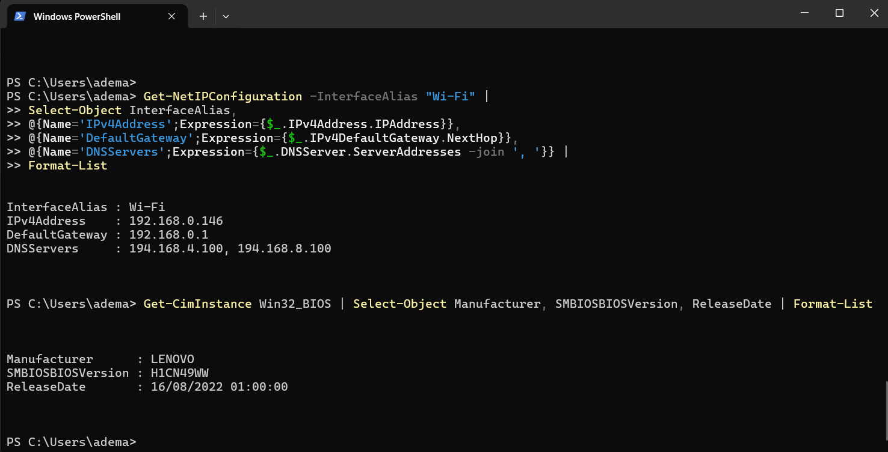

# Lab 02 — System Information and Inventory

**Status:** Complete  
**Date:** 14 November 2026  
**Environment:** Personal Windows laptop  
**Operating System:** Windows 11 Pro  
**PowerShell:** Windows PowerShell 5.1

## Objective

Use PowerShell to collect and document essential Windows system information, including operating system details, hardware specifications, storage capacity, processor information, network configuration, and BIOS firmware.

This lab simulates a common IT Support task: gathering a computer's specifications for troubleshooting, asset inventory, and compatibility assessment.

## Lab Environment

| Component | Details |
|---|---|
| Manufacturer | Lenovo |
| Model | 82JK |
| Operating System | Windows 11 Pro |
| Architecture | 64-bit |
| Processor | Intel Core i7-11800H |
| Installed RAM | 31.85 GB |
| Primary Drive | C: |
| Storage Capacity | 952.17 GB |
| Network | Intel Wi-Fi 6 AX201 |
| BIOS Version | H1CN49WW |

## Practical Exercises

### Exercise 1 — Operating System Information

**Objective:** Identify the Windows edition, version, build number, architecture, installation date, and last boot time.

**Command:**

```powershell
Get-CimInstance Win32_OperatingSystem | Select-Object Caption, Version, BuildNumber, OSArchitecture, InstallDate, LastBootUpTime
```

**Results:**

| Property | Value |
|---|---|
| Operating System | Microsoft Windows 11 Pro |
| Version | 10.0.26300 |
| Build Number | 26300 |
| Architecture | 64-bit |
| Installation Date | 3 November 2024 |
| Last Boot | 13 November 2026, 21:24:08 |

**IT Support Application:**

Operating system information is useful for investigating software compatibility, Windows update problems, and system restart history.

**Outcome:** Successfully retrieved Windows operating system information.

**Screenshot:**



---

### Exercise 2 — Computer Hardware Information

**Objective:** Identify the computer manufacturer, model, architecture, and installed RAM.

**Command:**

```powershell
Get-CimInstance Win32_ComputerSystem | Select-Object Manufacturer, Model, SystemType, @{Name='RAM_GB';Expression={[math]::Round($_.TotalPhysicalMemory / 1GB, 2)}}
```

**Results:**

| Property | Value |
|---|---|
| Manufacturer | Lenovo |
| Model | 82JK |
| System Type | x64-based PC |
| Installed RAM | 31.85 GB |

**IT Support Application:**

Hardware identification assists with equipment inventories, software installation requirements, hardware upgrades, and performance troubleshooting.

**Outcome:** Successfully identified the computer model and installed physical memory.

**Screenshot:**



---

### Exercise 3 — Storage Information

**Objective:** Identify local storage drives, file systems, total capacity, and available free space.

**Command:**

```powershell
Get-CimInstance Win32_LogicalDisk -Filter "DriveType=3" | Select-Object DeviceID, VolumeName, FileSystem, @{Name='Size_GB';Expression={[math]::Round($_.Size / 1GB, 2)}}, @{Name='Free_GB';Expression={[math]::Round($_.FreeSpace / 1GB, 2)}}
```

**Results:**

| Property | Value |
|---|---|
| Drive | C: |
| File System | NTFS |
| Total Capacity | 952.17 GB |
| Available Space | 217.96 GB |
| Used Space | 734.21 GB |
| Storage Used | Approximately 77.1% |
| Storage Available | Approximately 22.9% |

**IT Support Application:**

Checking storage capacity helps diagnose low disk space, failed software installations, Windows update problems, and performance issues.

**Outcome:** Successfully retrieved local disk information and calculated storage utilisation.

**Screenshot:**



---

### Exercise 4 — Processor Information

**Objective:** Identify the CPU model, physical cores, logical processors, and reported maximum clock speed.

**Command:**

```powershell
Get-CimInstance Win32_Processor | Select-Object Name, NumberOfCores, NumberOfLogicalProcessors, MaxClockSpeed | Format-List
```

**Results:**

| Property | Value |
|---|---|
| Processor | 11th Gen Intel Core i7-11800H |
| Physical Cores | 8 |
| Logical Processors | 16 |
| Reported MaxClockSpeed | 2304 MHz |

**IT Support Application:**

Processor specifications help determine whether a computer meets application requirements and assist with hardware performance investigations.

**Outcome:** Successfully retrieved CPU specifications.

**Screenshot:**



---

### Exercise 5 — Network Adapter Information

**Objective:** Identify installed network adapters, their connection status, and reported link speeds.

**Command:**

```powershell
Get-NetAdapter | Select-Object Name, InterfaceDescription, Status, LinkSpeed | Format-Table -AutoSize
```

**Results:**

| Adapter | Status | Link Speed |
|---|---|---|
| Intel Wi-Fi 6 AX201 | Up | 54 Mbps |
| VirtualBox Host-Only Ethernet Adapter | Up | 1 Gbps |
| Realtek PCIe GbE Family Controller | Disconnected | 0 bps |
| Microsoft Wi-Fi Direct Virtual Adapter #2 | Up | 0 bps |

**IT Support Application:**

Network adapter inspection helps identify active and disconnected interfaces, distinguish physical adapters from virtual adapters, and investigate connectivity problems.

The reported link speed is not necessarily the same as internet download speed.

**Outcome:** Successfully identified four network adapters and their connection states.

**Screenshot:**



---

### Exercise 6 — IP Configuration

**Objective:** Identify the active Wi-Fi connection's IPv4 address, default gateway, and DNS servers.

**Command:**

```powershell
Get-NetIPConfiguration -InterfaceAlias "Wi-Fi" |
Select-Object InterfaceAlias,
@{Name='IPv4Address';Expression={$_.IPv4Address.IPAddress}},
@{Name='DefaultGateway';Expression={$_.IPv4DefaultGateway.NextHop}},
@{Name='DNSServers';Expression={$_.DNSServer.ServerAddresses -join ', '}} |
Format-List
```

**Results:**

| Property | Value |
|---|---|
| Network Interface | Wi-Fi |
| IPv4 Address | 192.168.0.146 |
| Default Gateway | 192.168.0.1 |
| Primary DNS Server | 194.168.4.100 |
| Secondary DNS Server | 194.168.8.100 |

**IT Support Application:**

IP configuration is essential for diagnosing network connectivity problems.

- **IPv4 address:** Identifies the computer on the local network.
- **Default gateway:** Routes traffic to other networks.
- **DNS servers:** Resolve domain names into IP addresses.

**Troubleshooting Observation:**

The initial command returned nested PowerShell objects instead of readable gateway and DNS addresses.

**Resolution:**

Updated the command to extract the `NextHop` and `ServerAddresses` properties.

The corrected command displayed the expected information.

**Outcome:** Successfully retrieved and documented the active Wi-Fi network configuration.

**Screenshot:**



---

### Exercise 7 — BIOS Information

**Objective:** Identify the BIOS manufacturer, firmware version, and release date.

**Command:**

```powershell
Get-CimInstance Win32_BIOS | Select-Object Manufacturer, SMBIOSBIOSVersion, ReleaseDate | Format-List
```

**Results:**

| Property | Value |
|---|---|
| Manufacturer | Lenovo |
| BIOS Version | H1CN49WW |
| Release Date | 16 August 2022 |

**IT Support Application:**

BIOS information is useful when investigating hardware compatibility, firmware-related issues, and startup problems.

Firmware should only be updated after verifying the correct update and following manufacturer guidance.

**Outcome:** Successfully retrieved BIOS information.

**Screenshot:**



---

## Skills Practised

- Windows system information gathering
- PowerShell CIM queries
- Hardware identification
- Memory inventory
- Storage capacity assessment
- Processor specification analysis
- Network adapter inspection
- IP configuration analysis
- DNS and gateway identification
- BIOS firmware inspection
- PowerShell pipelines and calculated properties
- Technical documentation

## Troubleshooting Observations

### Observation 1 — Network Configuration Formatting

**Issue:** The initial network configuration command displayed nested objects instead of readable gateway and DNS addresses.

**Action:** Used calculated properties in `Select-Object` to extract the required values.

**Result:** The corrected command successfully displayed the IPv4 address, default gateway, and DNS servers.

### Observation 2 — Disconnected Ethernet Adapter

**Finding:** The Realtek Ethernet adapter displayed a Disconnected status.

**Assessment:** This is expected when the wired network interface has no active connection. No fault was established.

### Observation 3 — Storage Utilisation

**Finding:** The primary drive had approximately 22.9% available capacity.

**Assessment:** Storage capacity was documented for future reference. No storage-related fault was established during this exercise.

## Safety Considerations

All exercises used read-only PowerShell commands.

No hardware configurations, network settings, storage volumes, or firmware settings were modified.

Network configuration details should be reviewed before publishing screenshots in public repositories.

## Lab Summary

| Exercise | Status |
|---|---|
| Operating System Information | Complete |
| Hardware and RAM Information | Complete |
| Storage Information | Complete |
| Processor Information | Complete |
| Network Adapter Information | Complete |
| IP Configuration | Complete |
| BIOS Information | Complete |

**Total Exercises Completed: 7/7**

## Conclusion

Lab 02 — System Information and Inventory was completed successfully.

PowerShell was used to collect operating system, hardware, storage, processor, network, and BIOS information from a Windows 11 laptop.

The exercises demonstrated how IT Support technicians can gather system information efficiently for asset inventory, troubleshooting, and compatibility assessments.

All seven exercises were documented with screenshot evidence.

**Next Lab:** Lab 03 — Windows Services, Processes and Event Logs.
