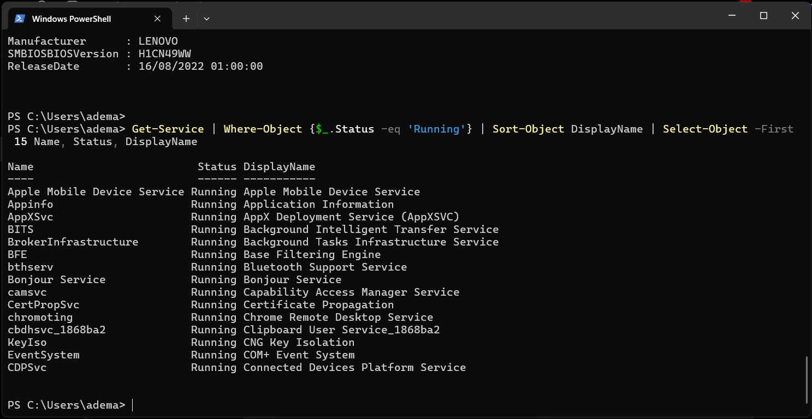
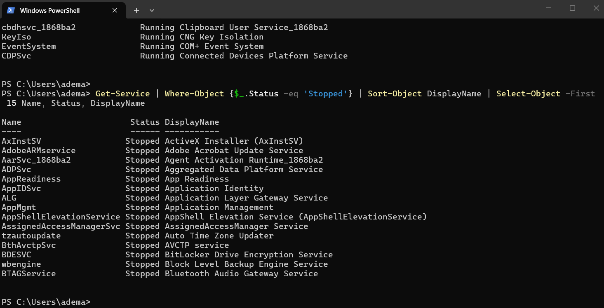
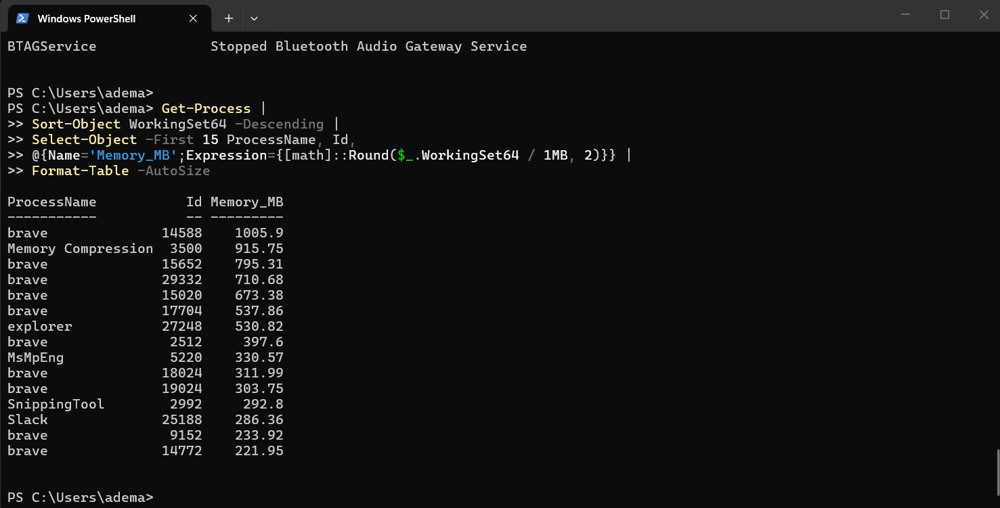
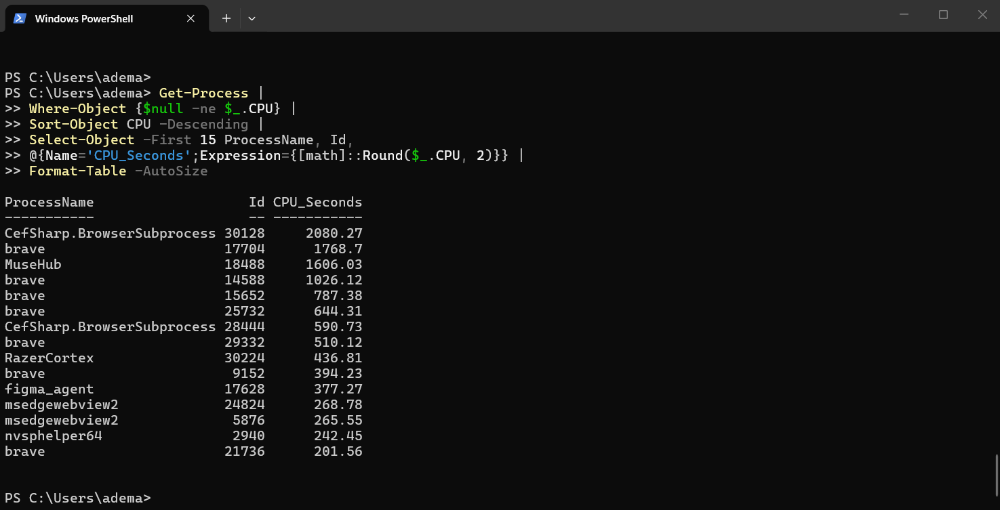
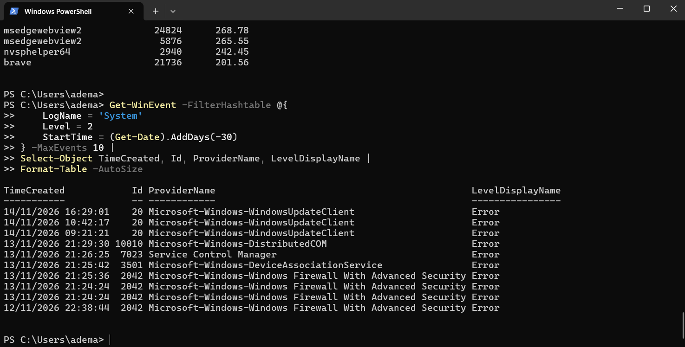
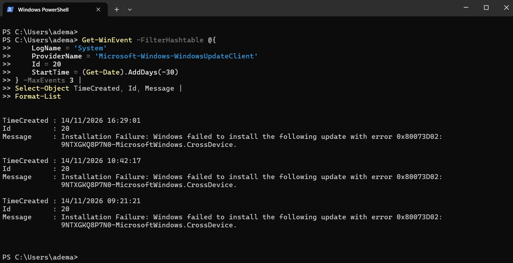
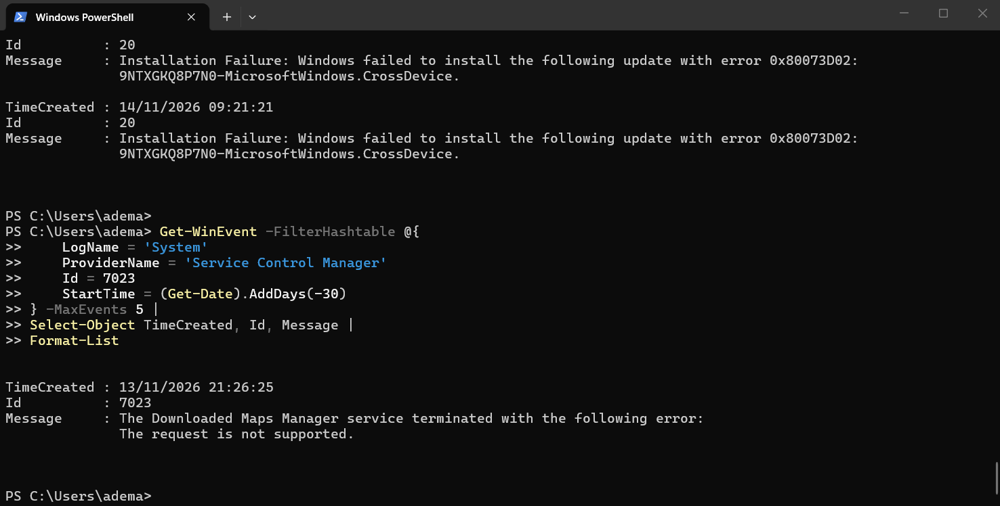

# Lab 03 — Windows Services, Processes and Event Logs

**Status:** Complete  
**Date:** 14 November 2026  
**Environment:** Personal Windows laptop  
**Operating System:** Windows 11 Pro  
**PowerShell:** Windows PowerShell 5.1

## Objective

Use PowerShell to monitor Windows services, inspect running processes, analyse CPU and memory consumption, and investigate Windows System Event Log errors.

This lab demonstrates practical troubleshooting techniques used by IT Support and Service Desk technicians.

## Lab Environment

| Component | Details |
|---|---|
| Manufacturer | Lenovo |
| Operating System | Windows 11 Pro |
| Processor | Intel Core i7-11800H |
| Installed RAM | Approximately 32 GB |
| Shell | Windows PowerShell 5.1 |
| Lab Type | Read-only system investigation |

## Practical Exercises

### Exercise 1 — Identify Running Windows Services

**Objective:** Identify Windows services currently running on the computer.

**Command:**

```powershell
Get-Service |
Where-Object {$_.Status -eq 'Running'} |
Sort-Object DisplayName |
Select-Object -First 15 Name, Status, DisplayName
```

**Result:**

Successfully retrieved 15 running Windows services.

Notable services included:

| Service | Purpose |
|---|---|
| BITS | Background Intelligent Transfer Service |
| BFE | Base Filtering Engine |
| bthserv | Bluetooth Support Service |
| AppXSvc | AppX Deployment Service |
| EventSystem | COM+ Event System |

**IT Support Application:**

Technicians inspect service status when investigating application failures, connectivity problems, and Windows functionality.

**Outcome:** Successfully filtered and displayed running Windows services.

**Screenshot:**



---

### Exercise 2 — Identify Stopped Windows Services

**Objective:** Identify Windows services that are currently stopped.

**Command:**

```powershell
Get-Service |
Where-Object {$_.Status -eq 'Stopped'} |
Sort-Object DisplayName |
Select-Object -First 15 Name, Status, DisplayName
```

**Result:**

Successfully retrieved 15 stopped Windows services.

Notable services included:

| Service | Status |
|---|---|
| Adobe Acrobat Update Service | Stopped |
| ActiveX Installer | Stopped |
| Application Identity | Stopped |
| BitLocker Drive Encryption Service | Stopped |
| Bluetooth Audio Gateway Service | Stopped |

**IT Support Application:**

Checking stopped services can help identify whether a service required by an application is unavailable.

A stopped service does not automatically indicate a fault. Some services are configured to start only when required.

**Outcome:** Successfully identified stopped Windows services without changing their status.

**Screenshot:**



---

### Exercise 3 — Inspect Running Processes and Memory Usage

**Objective:** Identify processes consuming the most physical memory.

**Command:**

```powershell
Get-Process |
Sort-Object WorkingSet64 -Descending |
Select-Object -First 15 ProcessName, Id,
@{Name='Memory_MB';Expression={[math]::Round($_.WorkingSet64 / 1MB, 2)}} |
Format-Table -AutoSize
```

**Result:**

Successfully retrieved the 15 processes with the highest reported working-set memory usage.

Selected results:

| Process | Memory (MB) |
|---|---:|
| brave | 1005.90 |
| Memory Compression | 915.75 |
| brave | 795.31 |
| brave | 710.68 |
| explorer | 530.82 |
| MsMpEng | 330.57 |
| Slack | 286.36 |

**Observations:**

- Brave appeared multiple times because browsers use multiple processes.
- Memory Compression was active as part of Windows memory management.
- Microsoft Defender's MsMpEng process was running.
- High memory consumption alone does not establish a performance fault.

The `WorkingSet64` property reports physical memory associated with each process, rather than total private memory usage.

**IT Support Application:**

Process monitoring helps technicians investigate slow computers, application performance complaints, and potential resource constraints.

**Outcome:** Successfully identified memory-intensive processes.

**Screenshot:**



---

### Exercise 4 — Investigate CPU Time

**Objective:** Identify processes that have accumulated the most CPU processing time.

**Command:**

```powershell
Get-Process |
Where-Object {$null -ne $_.CPU} |
Sort-Object CPU -Descending |
Select-Object -First 15 ProcessName, Id,
@{Name='CPU_Seconds';Expression={[math]::Round($_.CPU, 2)}} |
Format-Table -AutoSize
```

**Result:**

Successfully retrieved the 15 processes with the highest cumulative CPU time.

Selected results:

| Process | CPU Time (Seconds) |
|---|---:|
| CefSharp.BrowserSubprocess | 2080.27 |
| brave | 1768.70 |
| MuseHub | 1606.03 |
| brave | 1026.12 |
| brave | 787.38 |

**Observations:**

- CefSharp.BrowserSubprocess had the highest cumulative CPU time among the displayed processes.
- Multiple Brave processes appeared in the results.
- CPU time represents accumulated processor time since process startup, not current CPU utilisation percentage.

**IT Support Application:**

Cumulative CPU time can help identify processes worth investigating during performance troubleshooting.

Further monitoring would be required to determine whether a process is currently causing high CPU utilisation.

**Outcome:** Successfully collected and analysed cumulative CPU time.

**Screenshot:**



---

### Exercise 5 — Investigate Windows System Event Log Errors

**Objective:** Retrieve recent error events from the Windows System Event Log.

**Command:**

```powershell
Get-WinEvent -FilterHashtable @{
    LogName = 'System'
    Level = 2
    StartTime = (Get-Date).AddDays(-30)
} -MaxEvents 10 |
Select-Object TimeCreated, Id, ProviderName, LevelDisplayName |
Format-Table -AutoSize
```

**Result:**

Successfully retrieved 10 recent System log error events.

| Event ID | Provider | Events Displayed |
|---|---|---:|
| 20 | Windows Update Client | 3 |
| 10010 | DistributedCOM | 1 |
| 7023 | Service Control Manager | 1 |
| 3501 | Device Association Service | 1 |
| 2042 | Windows Firewall with Advanced Security | 4 |

**Observations:**

The events identified several components that had recorded errors.

An error event does not automatically indicate an ongoing fault. The event description and surrounding system behaviour must be examined before drawing conclusions.

**IT Support Application:**

Windows Event Logs help technicians investigate application failures, service problems, update failures, and unexpected system behaviour.

**Outcome:** Successfully filtered and identified Windows System error events.

**Screenshot:**



---

### Exercise 6 — Investigate Windows Update Installation Failures

**Objective:** Retrieve detailed information about Windows Update Client Event ID 20.

**Command:**

```powershell
Get-WinEvent -FilterHashtable @{
    LogName = 'System'
    ProviderName = 'Microsoft-Windows-WindowsUpdateClient'
    Id = 20
    StartTime = (Get-Date).AddDays(-30)
} -MaxEvents 3 |
Select-Object TimeCreated, Id, Message |
Format-List
```

**Result:**

Three Windows Update installation failures were identified.

| Property | Value |
|---|---|
| Event ID | 20 |
| Provider | Microsoft-Windows-WindowsUpdateClient |
| Error Code | 0x80073D02 |
| Affected Package | MicrosoftWindows.CrossDevice |
| Failed Attempts Retrieved | 3 |
| Date | 14 November 2026 |

**Error Message:**

Installation Failure: Windows failed to install the update with error 0x80073D02.

**Analysis:**

Error 0x80073D02 generally indicates that an application package cannot be updated because resources it needs to modify are currently in use.

The event records show that the MicrosoftWindows.CrossDevice package failed to install on three occasions.

The logs do not establish whether a later update attempt succeeded.

**IT Support Application:**

Technicians use event descriptions and error codes to identify affected software and determine appropriate troubleshooting steps.

**Outcome:** Successfully identified the update package and associated installation error.

**Resolution Status:** Not resolved or retested during this lab. Investigation only.

**Screenshot:**



---

### Exercise 7 — Investigate Service Control Manager Error

**Objective:** Identify the service associated with Event ID 7023 and retrieve its error description.

**Command:**

```powershell
Get-WinEvent -FilterHashtable @{
    LogName = 'System'
    ProviderName = 'Service Control Manager'
    Id = 7023
    StartTime = (Get-Date).AddDays(-30)
} -MaxEvents 5 |
Select-Object TimeCreated, Id, Message |
Format-List
```

**Result:**

Successfully retrieved the following event:

| Property | Value |
|---|---|
| Event ID | 7023 |
| Provider | Service Control Manager |
| Service | Downloaded Maps Manager |
| Date | 13 November 2026 |
| Time | 21:26:25 |
| Error | The request is not supported. |

**Error Message:**

The Downloaded Maps Manager service terminated with the following error: The request is not supported.

**Analysis:**

The Downloaded Maps Manager service supports offline maps functionality in Windows.

The event confirms that the service terminated with an error.

The underlying cause and whether the issue is ongoing were not established.

**IT Support Application:**

Service Control Manager events help technicians identify services that have terminated unexpectedly or failed during operation.

**Outcome:** Successfully identified the affected service and retrieved its error description.

**Resolution Status:** Investigation only. No service changes were performed.

**Screenshot:**



---

## Troubleshooting Findings

### Finding 1 — Windows Update Installation Failure

**Issue:** Three installation failures involving MicrosoftWindows.CrossDevice.

**Evidence:** Windows Update Client Event ID 20.

**Error Code:** 0x80073D02.

**Assessment:** The error commonly occurs when application package resources are in use.

**Action Taken:** Retrieved and analysed event messages using PowerShell.

**Status:** Cause not independently confirmed; no remediation performed.

### Finding 2 — Downloaded Maps Manager Service Error

**Issue:** Downloaded Maps Manager terminated with an error.

**Evidence:** Service Control Manager Event ID 7023.

**Error Message:** The request is not supported.

**Action Taken:** Retrieved the event details and identified the affected service.

**Status:** Underlying cause not confirmed; no remediation performed.

### Finding 3 — Process Resource Consumption

**Observation:** Multiple Brave processes appeared among the highest memory and cumulative CPU-time consumers.

**Action Taken:** Collected process information using Get-Process.

**Status:** No performance fault established.

## Skills Practised

- Windows service monitoring
- PowerShell filtering and sorting
- Running process inspection
- Memory usage analysis
- Cumulative CPU-time analysis
- Windows Event Log investigation
- Event ID interpretation
- Windows Update error investigation
- Service Control Manager troubleshooting
- PowerShell calculated properties
- Technical troubleshooting documentation

## Safety Considerations

All exercises were performed using read-only PowerShell commands.

No Windows services were started, stopped, or reconfigured.

No processes were terminated.

No Windows updates were installed or removed.

No event logs were modified or cleared.

## Lab Summary

| Exercise | Status |
|---|---|
| Running Windows Services | Complete |
| Stopped Windows Services | Complete |
| Process Memory Usage | Complete |
| Cumulative CPU Time | Complete |
| Windows System Event Errors | Complete |
| Windows Update Error Investigation | Complete |
| Service Control Manager Investigation | Complete |

**Total Exercises Completed: 7/7**

## Conclusion

Lab 03 — Windows Services, Processes and Event Logs was completed successfully.

PowerShell was used to inspect Windows services, analyse process resource consumption, and retrieve System Event Log errors.

Two real system events were investigated in greater detail:

1. Windows Update installation failures involving MicrosoftWindows.CrossDevice.
2. A Downloaded Maps Manager service termination recorded by Service Control Manager.

The lab demonstrated the importance of collecting evidence and interpreting event messages before attempting corrective action.

All seven exercises were documented with screenshot evidence.

**Next Lab:** Lab 04 — Network Troubleshooting with PowerShell.
