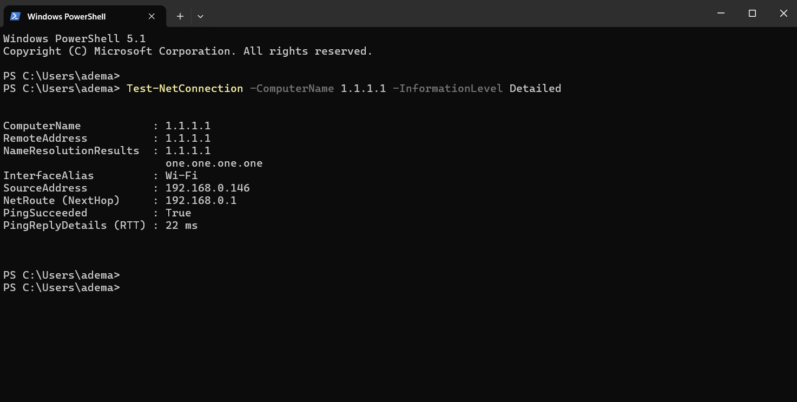
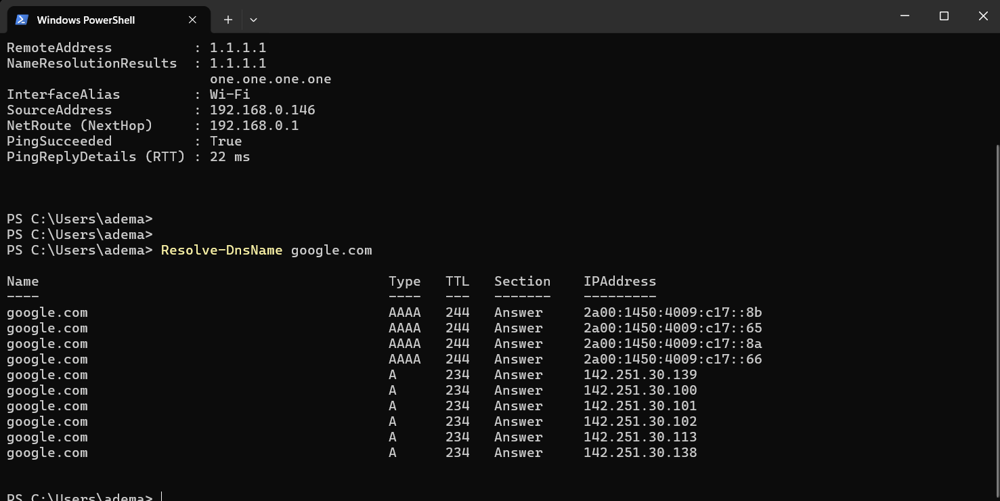
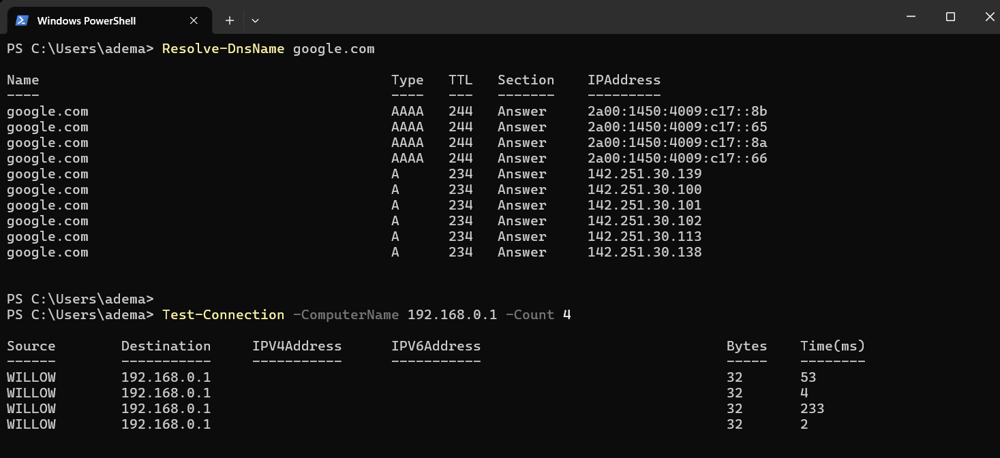
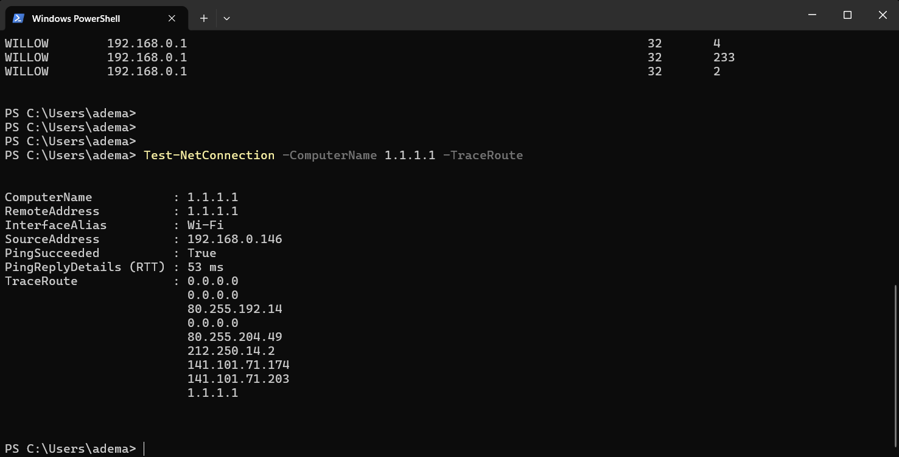
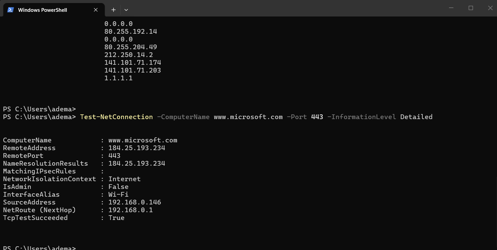
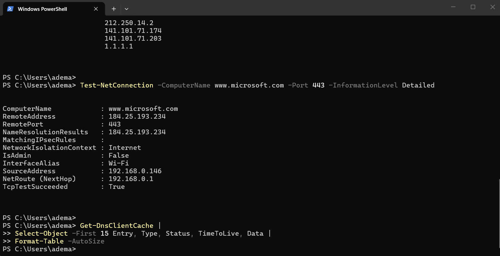
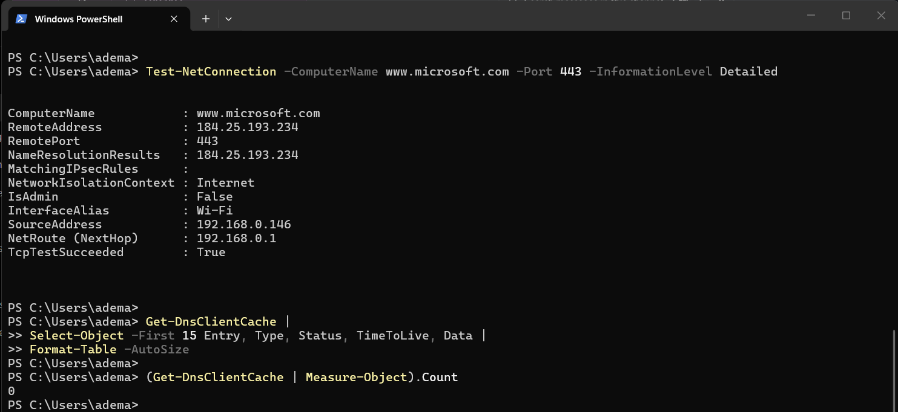
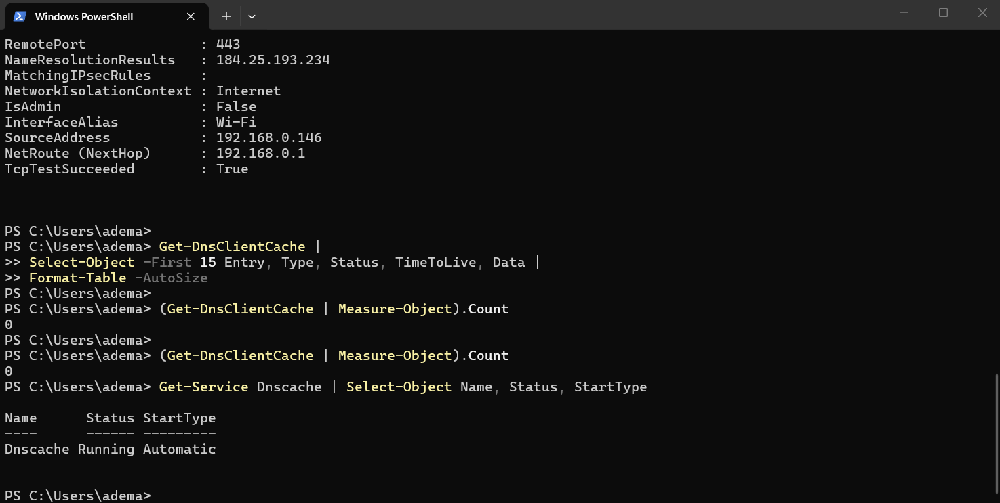
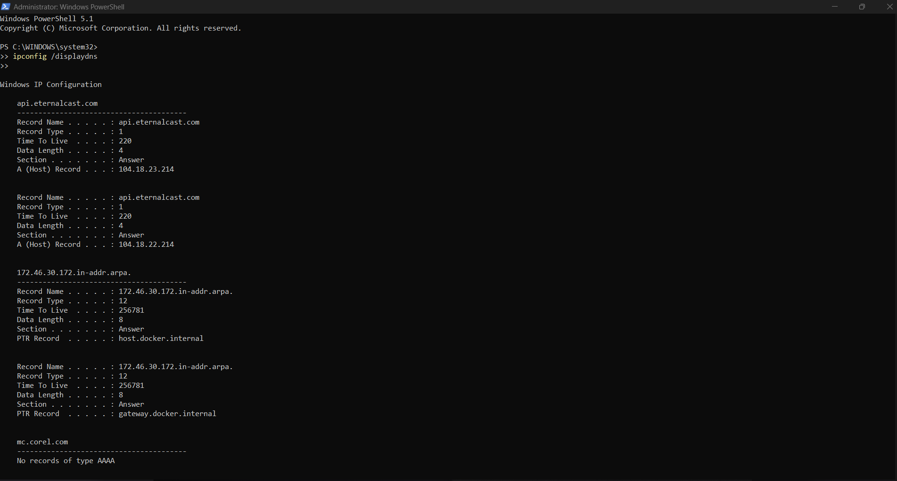

# Lab 04 — Network Troubleshooting with PowerShell

**Status:** Complete  
**Date:** 17 November 2026  
**Environment:** Personal Windows laptop  
**Operating System:** Windows 11 Pro  
**PowerShell:** Windows PowerShell 5.1

## Objective

Use PowerShell to investigate network connectivity, DNS resolution, local gateway communication, network routing, TCP port accessibility, and DNS client caching.

This lab demonstrates practical network troubleshooting techniques relevant to IT Support and Service Desk roles.

## Lab Environment

| Component | Details |
|---|---|
| Operating System | Windows 11 Pro |
| PowerShell | Windows PowerShell 5.1 |
| Connection | Wi-Fi |
| Local IPv4 Address | 192.168.0.146 |
| Default Gateway | 192.168.0.1 |
| DNS Servers | 194.168.4.100, 194.168.8.100 |
| Lab Type | Network diagnostics and investigation |

## Practical Exercises

### Exercise 1 — Test Internet Connectivity

**Objective:** Verify connectivity to an external IP address.

**Command:**

```powershell
Test-NetConnection -ComputerName 1.1.1.1 -InformationLevel Detailed
```

**Results:**

| Property | Result |
|---|---|
| Destination | 1.1.1.1 |
| Network Interface | Wi-Fi |
| Source Address | 192.168.0.146 |
| Default Gateway | 192.168.0.1 |
| Ping Succeeded | True |
| Round-Trip Time | 22 ms |

**Analysis:**

The computer successfully communicated with the external IP address.

This confirmed that IP connectivity was available during the test.

**IT Support Application:**

Testing an external IP address helps determine whether a device can communicate beyond its local network.

**Outcome:** Successful.

**Screenshot:**



---

### Exercise 2 — Test DNS Resolution

**Objective:** Verify that a domain name can be resolved to IP addresses.

**Command:**

```powershell
Resolve-DnsName google.com
```

**Results:**

The command successfully returned IPv4 and IPv6 DNS records for google.com.

The response included A records and AAAA records.

**Analysis:**

DNS resolution was functioning during the test.

The results demonstrated that the computer could retrieve address records for a public domain.

**IT Support Application:**

DNS troubleshooting is useful when a computer can reach IP addresses but cannot access websites using domain names.

**Outcome:** Successful.

**Screenshot:**



---

### Exercise 3 — Test Default Gateway Connectivity

**Objective:** Verify communication between the computer and its default gateway.

**Command:**

```powershell
Test-Connection -ComputerName 192.168.0.1 -Count 4
```

**Results:**

Four responses were received from the default gateway.

Reported response times were:

- 53 ms
- 4 ms
- 233 ms
- 2 ms

**Analysis:**

The gateway responded to all four requests.

Response times varied, including one higher-latency response of 233 ms. This short test alone does not establish a persistent network performance problem.

**IT Support Application:**

Gateway connectivity tests help distinguish local network problems from issues affecting external destinations.

**Outcome:** Successful.

**Screenshot:**



---

### Exercise 4 — Trace the Network Route

**Objective:** Examine the network path to an external destination.

**Command:**

```powershell
Test-NetConnection -ComputerName 1.1.1.1 -TraceRoute
```

**Results:**

The command displayed intermediate network hops and reached the destination address, 1.1.1.1.

Several intermediate hops appeared as 0.0.0.0.

The connectivity test also reported:

- PingSucceeded: True
- Round-Trip Time: 53 ms

**Analysis:**

The trace showed that traffic reached the destination through multiple network hops.

The 0.0.0.0 entries indicate hops for which the command did not obtain a usable router address. They do not, by themselves, prove a routing failure.

**IT Support Application:**

Route tracing helps technicians investigate where network traffic travels and identify possible points requiring further investigation.

**Outcome:** Successful.

**Screenshot:**



---

### Exercise 5 — Test TCP Port 443

**Objective:** Determine whether a remote HTTPS service is reachable over TCP port 443.

**Command:**

```powershell
Test-NetConnection -ComputerName www.microsoft.com -Port 443 -InformationLevel Detailed
```

**Results:**

| Property | Result |
|---|---|
| Destination | www.microsoft.com |
| Resolved Address | 184.25.193.234 |
| Remote Port | 443 |
| Network Interface | Wi-Fi |
| TcpTestSucceeded | True |

**Analysis:**

The TCP connection test succeeded.

This confirmed that a TCP connection to the tested destination on port 443 could be established.

The result does not independently verify the full HTTPS application response.

**IT Support Application:**

TCP port testing helps investigate access problems involving websites, applications, servers, and network services.

**Outcome:** Successful.

**Screenshot:**



---

### Exercise 6 — Investigate the DNS Client Cache

**Objective:** Inspect locally cached DNS records and investigate an unexpected empty result.

#### Step 1 — Inspect DNS Cache Entries

**Command:**

```powershell
Get-DnsClientCache |
Select-Object -First 15 Entry, Type, Status, TimeToLive, Data |
Format-Table -AutoSize
```

**Result:**

The command returned no displayed entries.

**Screenshot:**



#### Step 2 — Count DNS Cache Entries

**Command:**

```powershell
(Get-DnsClientCache | Measure-Object).Count
```

**Result:**

```text
0
```

The command confirmed that no cache entries were returned in the current PowerShell session.

**Screenshot:**



#### Step 3 — Verify the DNS Client Service

**Command:**

```powershell
Get-Service Dnscache | Select-Object Name, Status, StartType
```

**Results:**

| Property | Result |
|---|---|
| Service | Dnscache |
| Status | Running |
| Startup Type | Automatic |

**Analysis:**

The DNS Client service was running and configured for automatic startup.

The empty PowerShell result was therefore not explained by the service being stopped.

**Screenshot:**



#### Step 4 — Verify DNS Cache Using Administrator PowerShell

**Command:**

```powershell
ipconfig /displaydns
```

**Initial Result:**

Running the command without administrator privileges produced:

```text
The requested operation requires elevation.
```

**Action Taken:**

Windows PowerShell was reopened using Run as Administrator.

The command was executed again.

**Final Result:**

The command successfully displayed DNS cache records, including A and PTR records.

The displayed records included domain names, record types, time-to-live values, and resolved addresses.

**Analysis:**

The administrator command confirmed that DNS cache records were present.

The earlier `Get-DnsClientCache` command had returned zero entries, but the exact cause of the difference between the two results was not established.

DNS resolution and external network connectivity had already been confirmed by earlier exercises.

No DNS cache clearing, service restart, or configuration change was performed.

**Outcome:** DNS cache investigation completed and findings documented.

**Screenshot:**



---

## Troubleshooting Findings

### Finding 1 — Internet Connectivity

**Finding:** External IP connectivity succeeded.

**Evidence:** Test-NetConnection to 1.1.1.1.

**Status:** Successful during testing.

### Finding 2 — DNS Resolution

**Finding:** The computer successfully resolved google.com to IPv4 and IPv6 addresses.

**Evidence:** Resolve-DnsName.

**Status:** Successful during testing.

### Finding 3 — Default Gateway

**Finding:** The default gateway responded to all four test requests.

**Evidence:** Test-Connection.

**Status:** Reachable during testing.

### Finding 4 — Network Routing

**Finding:** The trace reached 1.1.1.1, although some intermediate hops did not return usable addresses.

**Evidence:** Test-NetConnection -TraceRoute.

**Status:** Destination reached.

### Finding 5 — HTTPS Port Connectivity

**Finding:** TCP port 443 was reachable on www.microsoft.com.

**Evidence:** TcpTestSucceeded = True.

**Status:** Successful.

### Finding 6 — DNS Cache Inspection

**Issue:** Get-DnsClientCache returned zero entries in the initial session.

**Investigation:**

1. Confirmed the initial empty result.
2. Verified the reported cache entry count was zero.
3. Checked that the DNS Client service was running.
4. Attempted ipconfig /displaydns without elevation.
5. Repeated ipconfig /displaydns in Administrator PowerShell.
6. Successfully displayed DNS cache records.

**Assessment:**

The DNS cache was accessible through the elevated verification command.

The exact cause of the differing command results was not determined.

**Resolution Status:** Diagnostic verification completed. No system changes performed.

---

## Skills Practised

- PowerShell network troubleshooting
- Internet connectivity testing
- DNS resolution analysis
- Default gateway testing
- ICMP connectivity testing
- Network route tracing
- TCP port testing
- DNS cache inspection
- Windows service status verification
- Administrator privilege troubleshooting
- PowerShell command output interpretation
- Technical troubleshooting documentation

## Safety Considerations

The lab used diagnostic commands to inspect network connectivity and system information.

No network adapters were disabled.

No IP addresses or DNS servers were changed.

No Windows services were restarted or reconfigured.

The DNS cache was not cleared.

Administrator privileges were used only for the final DNS cache verification.

## Lab Summary

| Exercise | Status |
|---|---|
| Internet Connectivity Test | Complete |
| DNS Resolution | Complete |
| Default Gateway Test | Complete |
| Network Route Trace | Complete |
| TCP Port 443 Test | Complete |
| DNS Cache Investigation | Complete |

**Total Main Exercises Completed: 6/6**

**Screenshot Evidence: 9 screenshots (21–29)**

## Conclusion

Lab 04 — Network Troubleshooting with PowerShell was completed successfully.

The exercises demonstrated practical techniques for testing internet connectivity, DNS resolution, gateway communication, network routes, and TCP port accessibility.

The DNS cache exercise also provided an opportunity to investigate an unexpected command result, check a Windows service, and verify information using an elevated command prompt.

The lab demonstrated the importance of gathering evidence and confirming findings before making changes to a computer's network configuration.

**Next Lab:** Lab 05 — Local User and Group Management.
