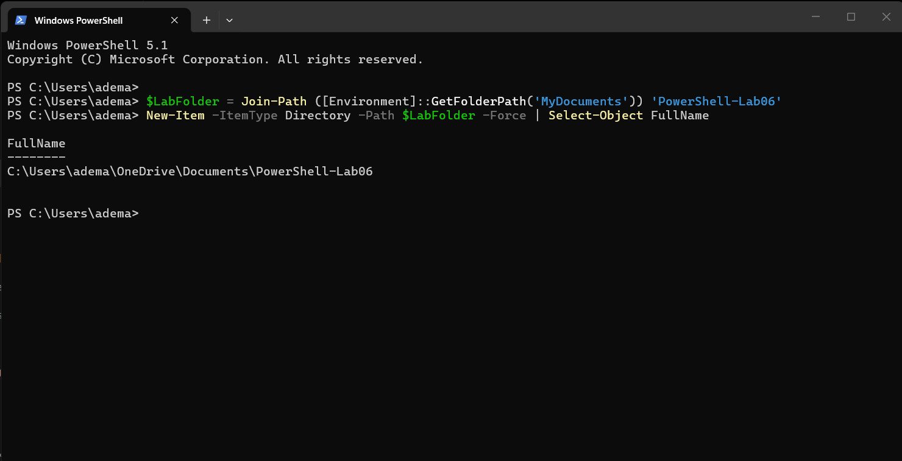
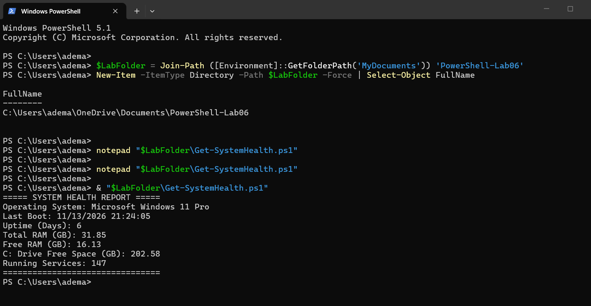
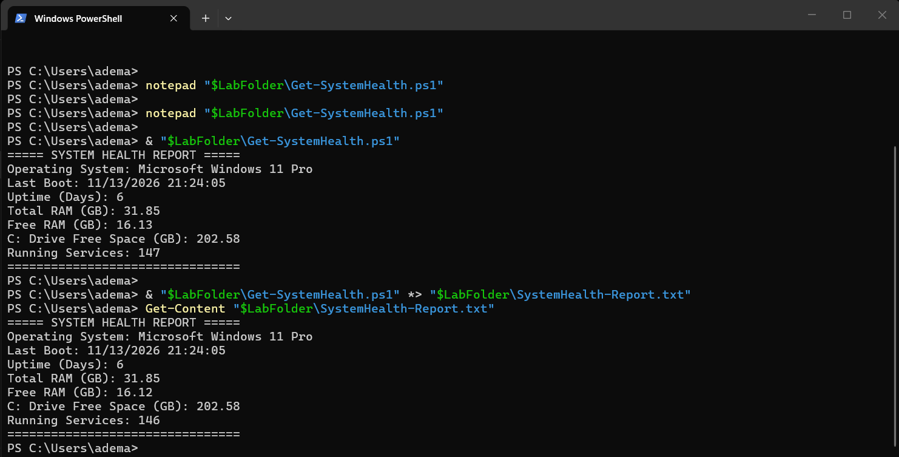
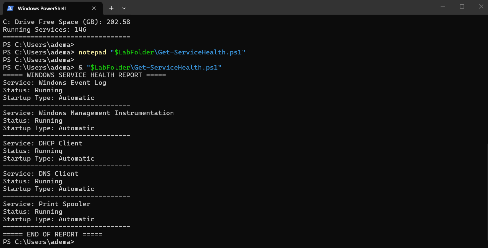
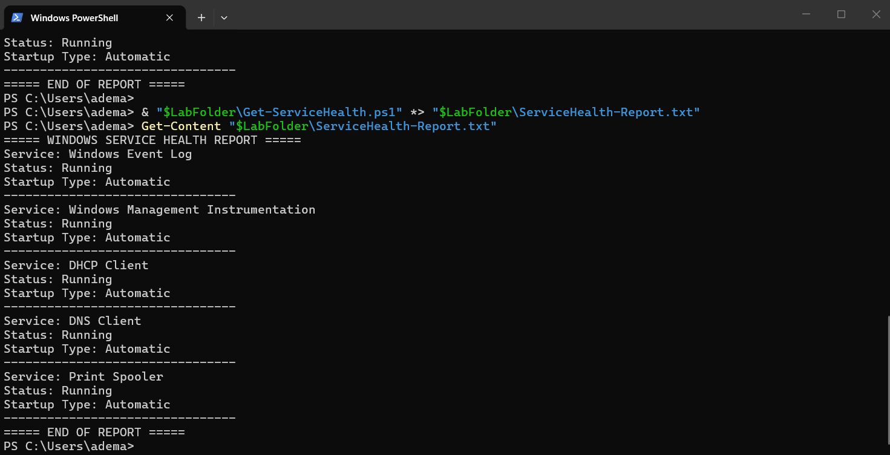
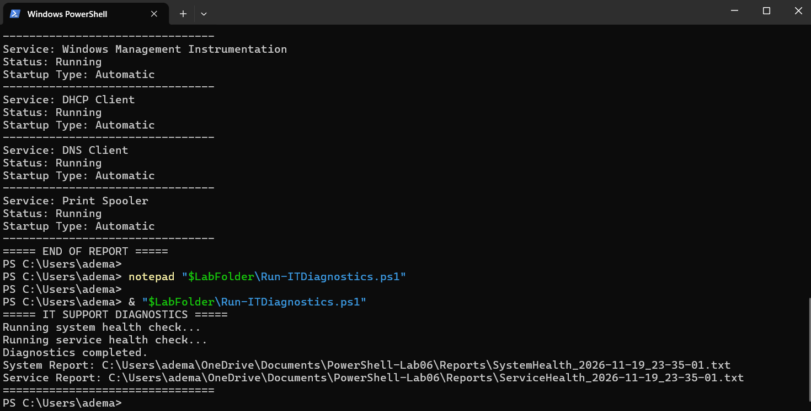
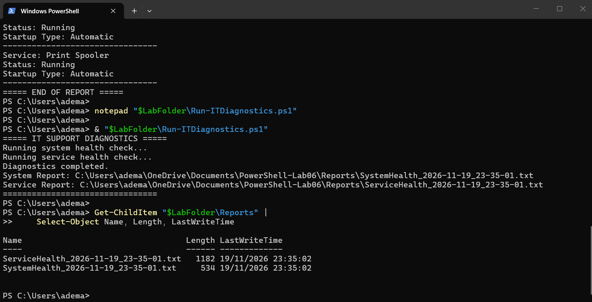

# Lab 06 — PowerShell Automation and Support Workflow

**Status:** Complete  
**Date:** 19 November 2026  
**Environment:** Personal Windows laptop  
**Operating System:** Windows 11 Pro  
**PowerShell:** Windows PowerShell 5.1

## Objective

Develop reusable PowerShell scripts to automate common IT Support diagnostic tasks, monitor important Windows services, and generate troubleshooting reports.

This lab demonstrates basic scripting, task automation, system monitoring, report generation, and technical documentation.

## Lab Environment

| Component | Details |
|---|---|
| Operating System | Windows 11 Pro |
| PowerShell | Windows PowerShell 5.1 |
| Lab Folder | PowerShell-Lab06 |
| Scripts Created | 3 |
| Diagnostic Reports | System Health and Service Health |
| Lab Type | Read-only diagnostics and automation |

## Practical Exercises

### Exercise 1 — Create the PowerShell Workspace

**Objective:** Create a dedicated directory for automation scripts and reports.

**Command:**

```powershell
$LabFolder = Join-Path ([Environment]::GetFolderPath('MyDocuments')) 'PowerShell-Lab06'
New-Item -ItemType Directory -Path $LabFolder -Force
```

**Result:** The PowerShell-Lab06 folder was created successfully inside Documents.

**Outcome:** Successful.

**Screenshot:**



---

### Exercise 2 — Automate System Health Checks

**Objective:** Develop a reusable script to collect basic Windows system information.

**Script:** [Get-SystemHealth.ps1](../scripts/Get-SystemHealth.ps1)

**Execution Command:**

```powershell
& "$LabFolder\Get-SystemHealth.ps1"
```

**Results:**

| System Check | Result |
|---|---|
| Operating System | Windows 11 Pro |
| Uptime | Approximately 6 days |
| Total RAM | 31.85 GB |
| Available RAM | 16.13 GB |
| Free C: Drive Space | 202.58 GB |
| Running Services | 147 |

**Analysis:**

The script successfully collected operating system information, uptime, memory availability, disk capacity, and running service counts.

These values represent the computer's condition at the time of testing and may change during subsequent executions.

**IT Support Application:**

Automated system health checks help technicians gather diagnostic information consistently when investigating computer performance and resource availability.

**Outcome:** Successful.

**Screenshot:**



---

### Exercise 3 — Export the System Health Report

**Objective:** Save diagnostic information to a text file for documentation and future reference.

**Commands:**

```powershell
& "$LabFolder\Get-SystemHealth.ps1" *> "$LabFolder\SystemHealth-Report.txt"
Get-Content "$LabFolder\SystemHealth-Report.txt"
```

**Result:**

The report was successfully saved as SystemHealth-Report.txt and displayed using Get-Content.

**IT Support Application:**

Saving diagnostic reports helps technicians document troubleshooting sessions and compare system conditions over time.

**Outcome:** Successful.

**Screenshot:**



---

### Exercise 4 — Automate Windows Service Monitoring

**Objective:** Monitor selected Windows services using PowerShell.

**Script:** [Get-ServiceHealth.ps1](../scripts/Get-ServiceHealth.ps1)

**Execution Command:**

```powershell
& "$LabFolder\Get-ServiceHealth.ps1"
```

**Services Monitored:**

| Service | Status During Testing |
|---|---|
| Windows Event Log | Running |
| Windows Management Instrumentation | Running |
| DHCP Client | Running |
| DNS Client | Running |
| Print Spooler | Running |

**Analysis:**

All five monitored services were running during the test.

The script also displayed startup configuration information.

A stopped service does not necessarily indicate a fault because some Windows services operate on demand.

**IT Support Application:**

Service monitoring helps technicians investigate application failures, connectivity issues, printing problems, and other Windows functionality.

**Outcome:** Successful.

**Screenshot:**



---

### Exercise 5 — Export the Service Health Report

**Objective:** Save Windows service information to a reusable troubleshooting report.

**Commands:**

```powershell
& "$LabFolder\Get-ServiceHealth.ps1" *> "$LabFolder\ServiceHealth-Report.txt"
Get-Content "$LabFolder\ServiceHealth-Report.txt"
```

**Result:**

The service report was saved and its contents displayed successfully.

**Outcome:** Successful.

**Screenshot:**



---

### Exercise 6 — Build an Automated Diagnostic Workflow

**Objective:** Combine multiple diagnostic scripts into one automated process.

**Script:** [Run-ITDiagnostics.ps1](../scripts/Run-ITDiagnostics.ps1)

**Execution Command:**

```powershell
& "$LabFolder\Run-ITDiagnostics.ps1"
```

**Workflow:**

1. Create a Reports directory if it does not exist.
2. Generate a timestamp.
3. Execute the system health script.
4. Execute the service monitoring script.
5. Save each report using a timestamped filename.
6. Display the report locations.

**Result:**

The workflow executed both scripts and displayed the message:

```text
Diagnostics completed.
```

Both report paths were displayed.

**IT Support Application:**

Combining diagnostic scripts into one workflow reduces repetitive manual tasks and helps standardise information collection.

**Outcome:** Successful.

**Screenshot:**



---

### Exercise 7 — Verify Generated Diagnostic Reports

**Objective:** Confirm that the automated workflow created report files containing data.

**Command:**

```powershell
Get-ChildItem "$LabFolder\Reports" |
    Select-Object Name, Length, LastWriteTime
```

**Results:**

| Report | File Size |
|---|---:|
| Service Health | 1,182 bytes |
| System Health | 534 bytes |

Both reports existed and had non-zero file sizes.

**Outcome:** Successful.

**Screenshot:**



---

## Scripts Developed

| Script | Purpose |
|---|---|
| Get-SystemHealth.ps1 | Collect Windows system health information |
| Get-ServiceHealth.ps1 | Monitor selected Windows services |
| Run-ITDiagnostics.ps1 | Execute both diagnostic scripts and save reports |

All scripts are stored in the repository's `scripts` directory.

## Skills Practised

- PowerShell scripting
- Variables and arrays
- Conditional logic and loops
- Windows system information retrieval
- Windows service monitoring
- PowerShell script execution
- Output redirection
- Automated report generation
- Timestamped filenames
- Reusable troubleshooting workflows
- GitHub documentation and version control

## Safety Considerations

The diagnostic scripts were designed to collect system information without changing Windows configuration.

No services were stopped, started, or reconfigured.

No user accounts or permissions were modified.

Generated reports containing local system information were retained on the personal computer rather than uploaded to the public repository.

## Lab Summary

| Exercise | Status |
|---|---|
| PowerShell Workspace Setup | Complete |
| System Health Automation | Complete |
| System Report Export | Complete |
| Windows Service Monitoring | Complete |
| Service Report Export | Complete |
| Automated Diagnostic Workflow | Complete |
| Report File Verification | Complete |

**Total Exercises Completed: 7/7**

**Screenshot Evidence: 7 screenshots (30–36)**

**PowerShell Scripts Created: 3**

## Conclusion

Lab 06 — PowerShell Automation and Support Workflow was completed successfully.

The exercises demonstrated how PowerShell can automate routine IT Support diagnostics, collect system information, monitor Windows services, and generate timestamped reports.

The practical work provided experience in developing reusable scripts and documenting their execution with screenshot evidence.

These skills are applicable to IT Support, Service Desk, Desktop Support, and junior Systems Administration roles.

**Lab 05:** Deferred because of virtual machine installation difficulties.
