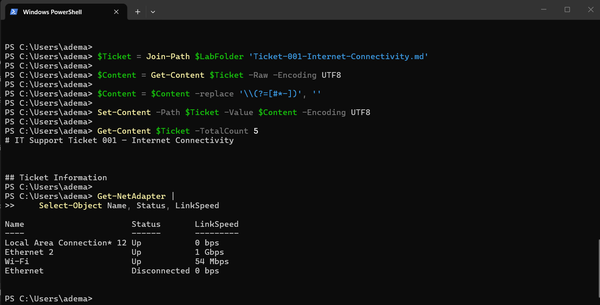
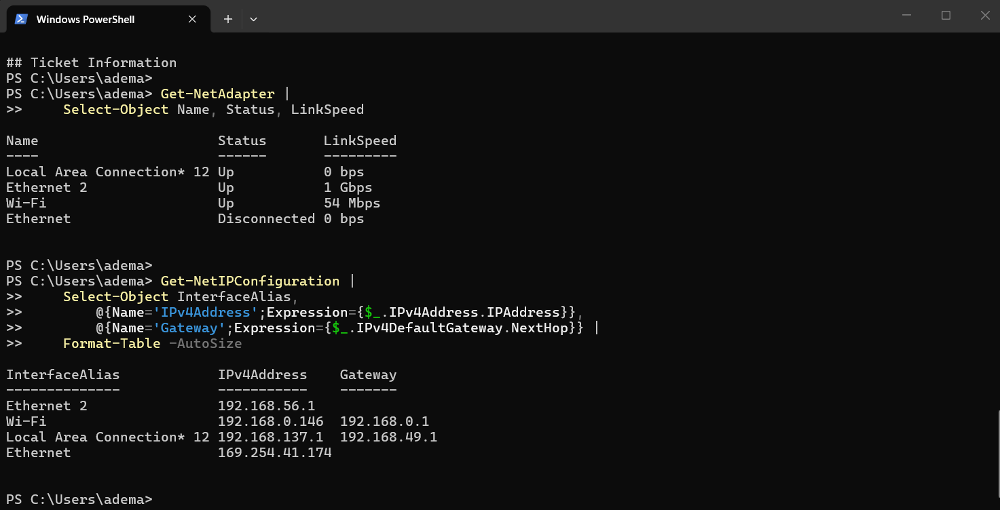
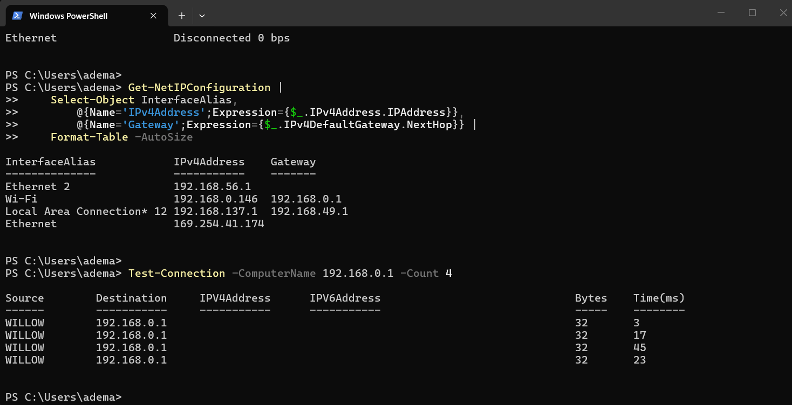
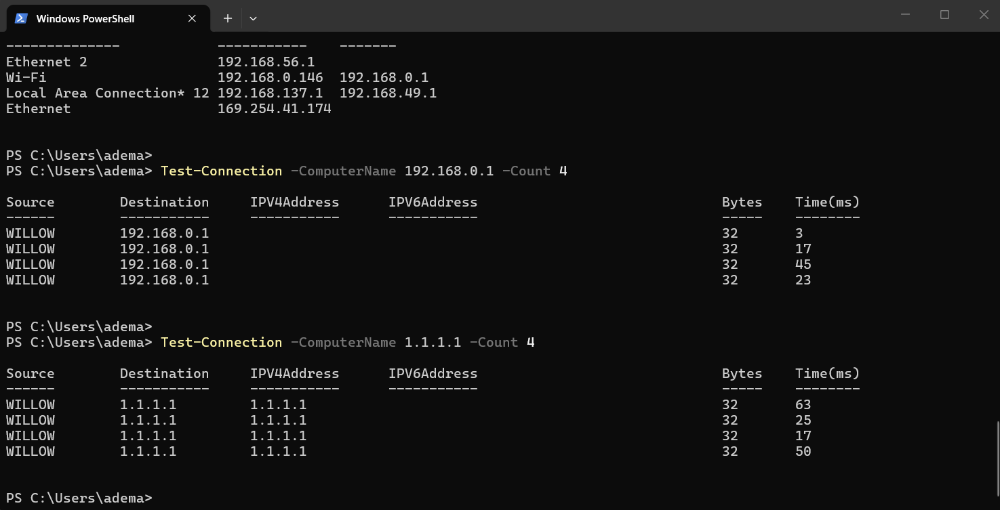
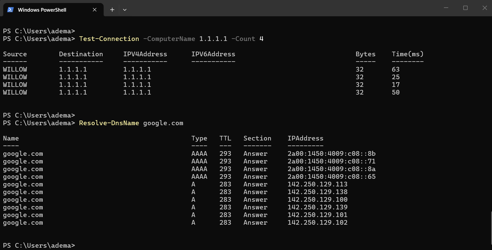
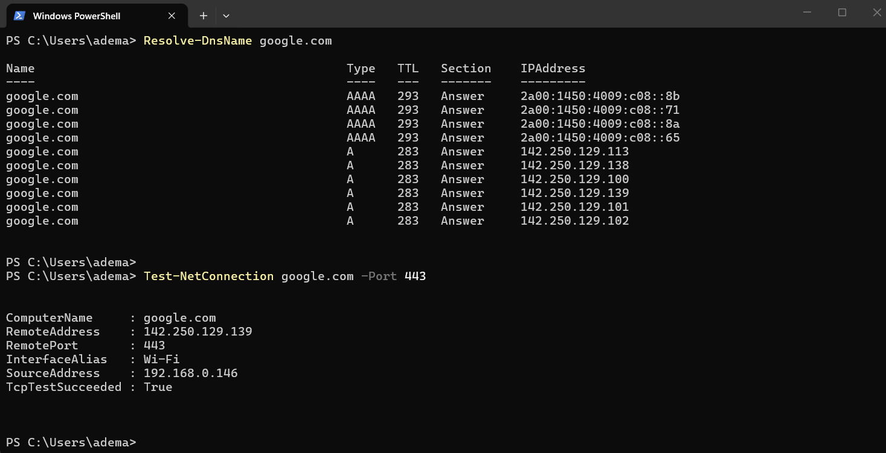

# IT Support Ticket 001 — Internet Connectivity

## Ticket Information

**Ticket ID:** INC-001  

**Date:** 21 November 2026  

**Category:** Network / Internet Connectivity  

**Priority:** Medium (Simulated)  

**Status:** Closed — Issue Not Reproduced  

**Environment:** Windows 11 Pro  

**Diagnostic Tool:** Windows PowerShell 5.1

## 1. Issue Description

A user reports being unable to access the internet from their Windows computer.

The objective of this simulated support ticket is to investigate network connectivity, identify potential causes, and document the troubleshooting results.

## 2. Troubleshooting Steps

### Step 1 — Check Network Adapters

**Command:** `Get-NetAdapter`

**Findings:**

- Wi-Fi adapter: Up

- Ethernet 2 adapter: Up

- Ethernet adapter: Disconnected

**Assessment:** Active network adapters were detected.

### Step 2 — Verify IP Configuration

**Command:** `Get-NetIPConfiguration`

**Findings:**

- Wi-Fi IPv4 address: 192.168.0.146

- Default gateway: 192.168.0.1

- Disconnected Ethernet adapter had a 169.254.x.x address.

**Assessment:** The Wi-Fi adapter had a valid private IP address and a configured default gateway.

### Step 3 — Test Default Gateway Connectivity

**Command:** `Test-Connection 192.168.0.1 -Count 4`

**Results:**

- Successful replies: 4/4

- Packet loss: 0%

- Response times: 5–47 ms

**Assessment:** Communication with the local router was successful.

### Step 4 — Test External IP Connectivity

**Command:** `Test-Connection 1.1.1.1 -Count 4`

**Results:**

- Successful replies: 4/4

- Packet loss: 0%

- Response times: 20–56 ms

**Assessment:** External IP connectivity was functioning.

### Step 5 — Verify DNS Resolution

**Command:** `Resolve-DnsName google.com`

**Results:**

- IPv4 address records returned successfully.

- IPv6 address records returned successfully.

- No DNS resolution errors observed.

**Assessment:** DNS resolution was functioning.

### Step 6 — Test HTTPS Connectivity

**Command:** `Test-NetConnection google.com -Port 443`

**Results:**

- Remote port: 443

- Network interface: Wi-Fi

- TcpTestSucceeded: True

**Assessment:** A TCP connection to the destination HTTPS port succeeded.

## 3. Root Cause Analysis

No network connectivity fault was identified during testing.

The computer successfully communicated with its default gateway, reached an external IP address, resolved a domain name, and established an outbound TCP connection on port 443.

Because the reported issue could not be reproduced, a root cause could not be established.

## 4. Resolution

No corrective action was required.

The troubleshooting process confirmed that the tested network functions were operating normally.

No network adapters, IP settings, DNS settings, or Windows services were modified.

## 5. Ticket Outcome

**Final Status:** Closed — Issue Not Reproduced

**Resolution Summary:** Network diagnostic checks completed successfully. No connectivity fault was detected during the simulated investigation.

## 6. Skills Demonstrated

- Network adapter inspection

- IP configuration analysis

- Default gateway connectivity testing

- External IP connectivity testing

- DNS troubleshooting

- TCP port connectivity testing

- Root cause assessment

- Service Desk ticket documentation

## 7. Technician Notes

This was a simulated IT Support scenario performed on a working Windows 11 computer.

## 8. Screenshot Evidence

The following screenshots document the PowerShell troubleshooting process performed for Ticket INC-001.

### 1. Network Adapter Inspection

Shows the status and link speeds of available network adapters.

### 2. IP Configuration

Shows the computer's IPv4 addresses and default gateway configuration.

### 3. Default Gateway Connectivity

Shows the connectivity test to the local router at 192.168.0.1.

### 4. External Internet Connectivity

Shows the external IP connectivity test using 1.1.1.1.

### 5. DNS Resolution

Shows successful DNS resolution for google.com.

### 6. HTTPS Connectivity

Shows the TCP connectivity test to google.com on port 443.

## 9. Final Verification

All six diagnostic tests were completed and documented.

**Final Ticket Status:** Closed — Issue Not Reproduced

**Evidence:** Six PowerShell screenshots uploaded to the GitHub repository.

**Conclusion:** No internet connectivity fault was detected during testing. No corrective changes were necessary.

The exercise demonstrated a structured troubleshooting approach and accurate documentation without introducing or repairing an actual network fault.

