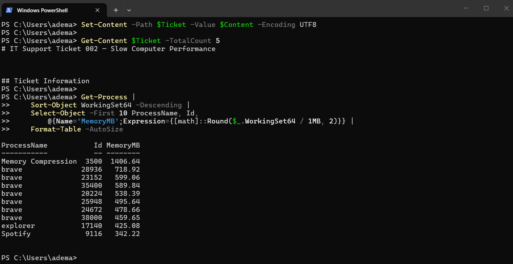
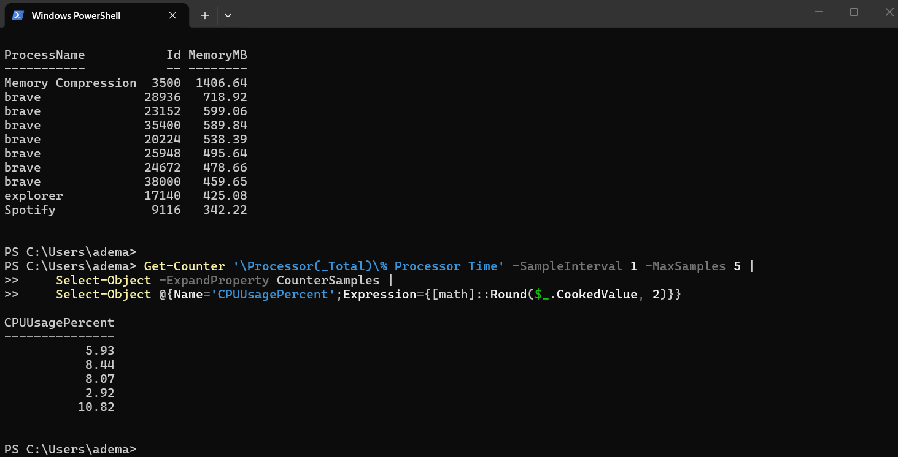
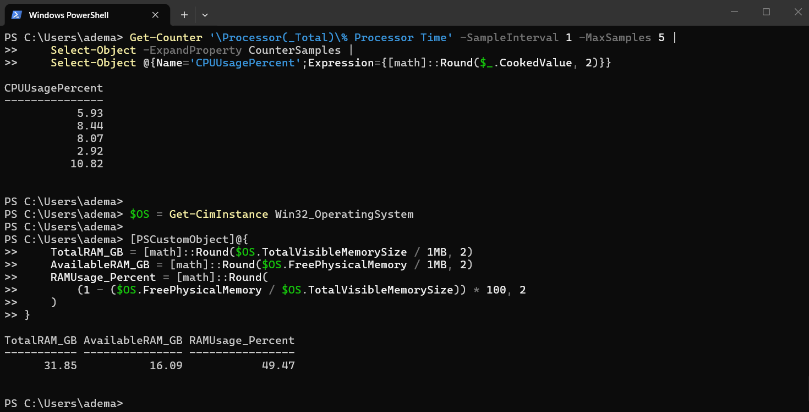
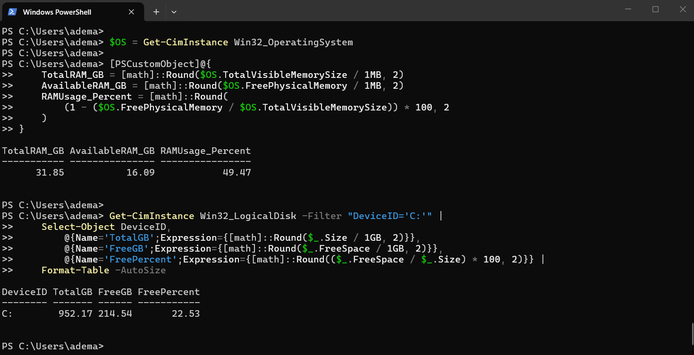
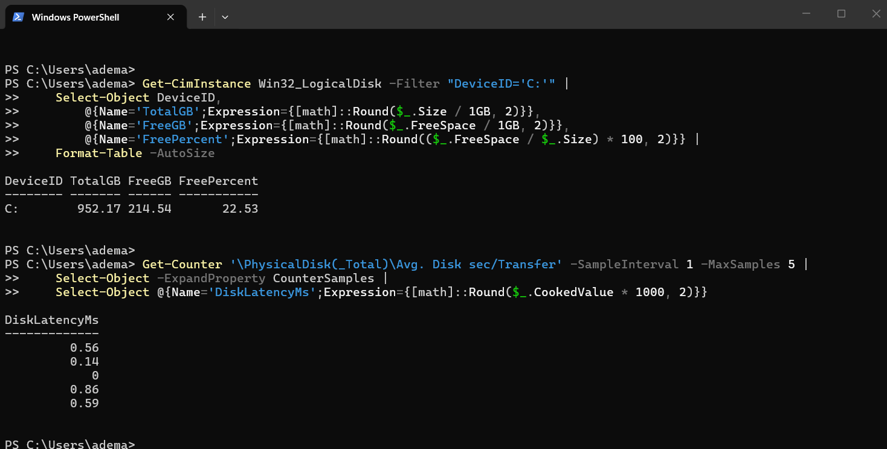

# IT Support Ticket 002 — Slow Computer Performance

## Ticket Information

**Ticket ID:** INC-002  

**Date:** 21 November 2026  

**Category:** Hardware / System Performance  

**Priority:** Medium (Simulated)  

**Status:** Closed — Issue Not Reproduced  

**Environment:** Windows 11 Pro  

**Diagnostic Tool:** Windows PowerShell 5.1

## 1. Issue Description

A user reports that their Windows computer is running unusually slowly.

The objective of this simulated IT Support ticket is to investigate potential performance bottlenecks involving running processes, CPU utilisation, physical memory, disk capacity, and disk response times.

The investigation was conducted using read-only PowerShell commands.

## 2. Troubleshooting Steps

### Step 1 — Identify Memory-Intensive Processes

**Command:** `Get-Process`

Processes were sorted by their physical memory usage using `WorkingSet64`.

**Findings:**

| Process | Memory Usage |

|---|---:|

| Memory Compression | 1,599.63 MB |

| Brave Browser (highest instance) | 523.48 MB |

| Windows Explorer | 419.75 MB |

| Spotify | 313.31 MB |

| Microsoft Defender (MsMpEng) | 299.98 MB |

Multiple Brave Browser processes were observed.

**Assessment:** Several applications were consuming memory, but the results did not establish excessive memory pressure or identify a malfunctioning process.

### Step 2 — Measure CPU Utilisation

**Command:** `Get-Counter '\\Processor(\_Total)\\% Processor Time'`

**Results:**

| Sample | CPU Usage |

|---|---:|

| 1 | 3.21% |

| 2 | 8.57% |

| 3 | 2.41% |

| 4 | 1.33% |

| 5 | 6.00% |

**Average CPU Utilisation:** 4.30%

**Assessment:** CPU utilisation was low during the five samples. No sustained CPU bottleneck was observed during testing.

### Step 3 — Analyse Physical Memory

**Command:** `Get-CimInstance Win32\_OperatingSystem`

**Results:**

- Total physical RAM: 31.85 GB

- Available RAM: 16.72 GB

- RAM utilisation: 47.51%

**Assessment:** Approximately half of the available physical memory was in use. No evidence of memory exhaustion was identified during testing.

### Step 4 — Check Disk Capacity

**Command:** `Get-CimInstance Win32\_LogicalDisk`

**Results:**

- Drive: C:

- Total capacity: 952.17 GB

- Available storage: 214.80 GB

- Free storage: 22.56%

**Assessment:** The system drive had approximately 215 GB of available storage. Insufficient free disk space was not identified as a likely cause of poor performance.

### Step 5 — Measure Disk Response Time

**Command:** `Get-Counter '\\PhysicalDisk(\_Total)\\Avg. Disk sec/Transfer'`

**Results:**

| Sample | Disk Latency |

|---|---:|

| 1 | 0.75 ms |

| 2 | 0.13 ms |

| 3 | 0.68 ms |

| 4 | 1.73 ms |

| 5 | 1.11 ms |

**Average Disk Latency:** 0.88 ms

**Assessment:** Disk response times were low during testing. No significant disk latency was observed in the collected samples.

## 3. Root Cause Analysis

No specific performance fault was identified during the investigation.

The diagnostic results showed:

- Low CPU utilisation.

- Available physical memory.

- Sufficient free storage space.

- Low disk response times.

- No confirmed malfunctioning process.

The short monitoring period cannot rule out intermittent performance problems.

Because the reported performance issue was not reproduced, a definitive root cause could not be established.

## 4. Resolution

No corrective action was performed.

The investigation did not identify a condition requiring immediate intervention.

No running processes were terminated, Windows services were modified, or system settings were changed.

For a real unresolved incident, further investigation could include collecting the user's exact symptoms, identifying affected applications, monitoring resource utilisation over a longer period, and reviewing relevant system events.

## 5. Ticket Outcome

**Final Status:** Closed — Issue Not Reproduced

**Resolution Summary:** System performance diagnostics completed successfully. No significant CPU, RAM, or disk performance bottleneck was observed during testing.

**Corrective Actions:** None required during the simulated investigation.

## 6. Skills Demonstrated

- Windows process inspection

- CPU performance monitoring

- Physical memory analysis

- Disk capacity assessment

- Disk latency monitoring

- PowerShell performance counters

- Troubleshooting methodology

- Root cause assessment

- Service Desk ticket documentation

## 7. Technician Notes

This was a simulated IT Support scenario performed on a Windows 11 Pro computer.

All diagnostic commands were read-only.

The investigation demonstrated a structured approach to assessing Windows performance without making potentially disruptive changes to the operating system.

## 8. Screenshot Evidence

The following screenshots document the PowerShell diagnostic checks performed during this investigation.

### Process Memory Usage

### CPU Utilisation

### RAM Utilisation

### Disk Space

### Disk Latency

**Final Conclusion:** No performance fault was reproduced during the testing period.

